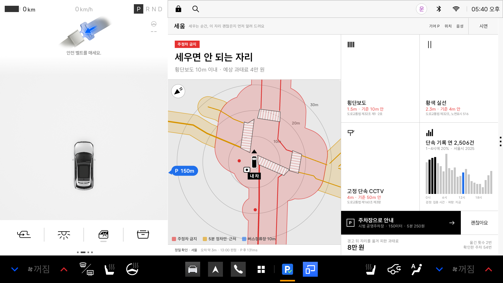
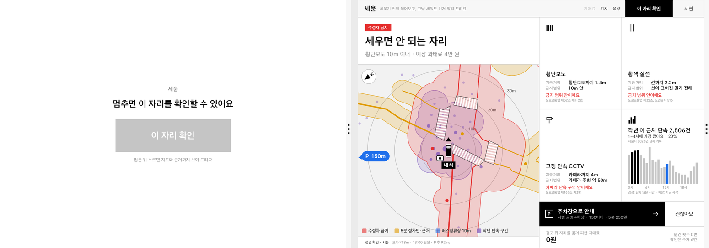
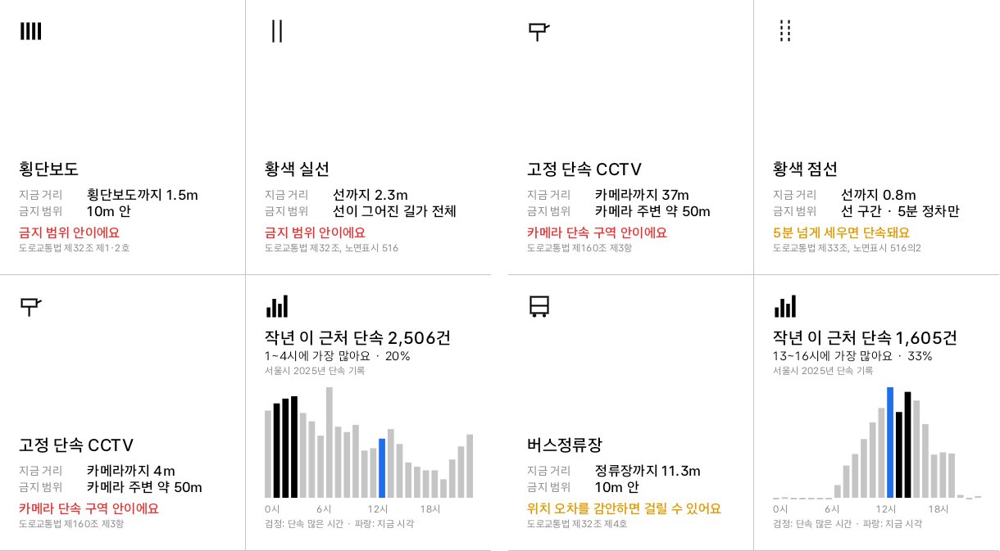

# 세움 (Seum)

**세우기 전에는 버튼 하나로 이 자리가 주정차 금지 구역인지 확인하고, 모르고 그냥 세웠더라도 기어를 P에 넣는 순간 차량이 먼저 알려 주는 주차 보호 앱**입니다.
Pleos Connect(AAOS) 차량용 앱으로, 현대자동차그룹 차량용 앱 개발 공모전 출품작입니다.



## 주요 기능

| 기능 | 내용 |
|---|---|
| 세우기 전 — 이 자리 확인 | D단으로 잠깐 멈춘 상태에서 버튼을 누르면 지금 자리를 바로 판정해 음성으로 답합니다. 정차 중에 누르면 P에 넣었을 때와 같은 지도·근거 화면이 뜨고, 차가 움직이기 시작하면 버튼이 잠긴 최소 화면으로 바로 돌아갑니다. |
| 세운 뒤 — P 순간 자동 판정 | 차속 0 + 기어 P 신호를 받는 순간 자동으로 판정합니다(에뮬레이터 측정 0.1~0.4초). 버튼으로 이미 확인한 자리는 반복해서 말하지 않습니다. |
| 조용한 음성 안내 | 문제가 있을 때만 한 문장으로 말합니다. 아파트 단지·주차장 안, 위치가 불확실한 곳(지하 등), 자주 세우는 자리에서는 말하지 않습니다. |
| 근거와 범위 화면 | 차 앞이 위로 오는 범위 지도에 법정 거리 구역, 황색 실선·점선, 횡단보도, 고정 CCTV 범위, 작년 단속 지점·구간을 표시합니다. "지금 거리 1.5m · 금지 범위 10m 안"처럼 보여 줍니다. |
| 단속 시간대 안내 | 서울시 2025년 단속 기록을 시간대별로 분석해 단속이 몰리는 시간을 알려 줍니다. |
| 음성으로 답하는 주차장 안내 | "안내할까요?"에 "응"이라고 답하면 내비게이션에 공영주차장 경로가 잡힙니다(공영 우선, 없으면 일반 주차장). |

| 이 자리 확인: 주행 중(왼쪽) → D단 정차 후 누름(오른쪽) | 근거 칸 (수유 시장 · 익선동) |
|---|---|
|  |  |

## APK · 시연 영상

| 항목 | 위치 |
|---|---|
| APK (release 1.0.1) | [GitHub Release v1.0.1](https://github.com/panorama2508/seum-pleos-parking/releases/tag/v1.0.1)의 `seum-1.0.1.apk` (약 126MB로 GitHub 파일 업로드 한도를 넘어 Releases에 등록) |
| 시연 영상 (1분 20초) | [seum-demo-video.mp4](https://github.com/panorama2508/seum-pleos-parking/releases/download/v1.0.1/seum-demo-video.mp4) — 에뮬레이터 실제 동작, 실제 Pleos 음성 |

## 실행 방법

1. 아래 [개발·실행 환경](#개발실행-환경)의 Pleos Connect 에뮬레이터를 실행합니다.
2. APK를 설치합니다: `adb install -r seum-1.0.1.apk`
3. 앱 목록에서 **세움**을 열고 위치·알림 권한을 허용합니다. 처음 실행할 때 내장 지도 데이터를 푸느라 몇 초 걸립니다. 한 번 열면 이후에는 앱을 열지 않아도 백그라운드에서 P 순간을 감지합니다.
4. 차량 신호는 Virtual Console(`adb forward tcp:8088 tcp:8088` 후 브라우저에서 `http://127.0.0.1:8088`)로 바꿉니다.
   - **이 자리 확인:** 기어 D, 속도 0(브레이크)으로 정차한 뒤 버튼을 누릅니다.
   - **P 자동 판정:** 정차 후 기어를 P로 바꿉니다. 내비게이션이 앞에 있어도 음성으로 알려 줍니다.
   - 위치는 `adb emu geo fix <경도> <위도>`로 옮깁니다. 앱 오른쪽 위 **시연** 버튼을 쓰면 서울 5곳을 바로 재현할 수 있습니다.
5. 평가용 APK는 debuggable로 빌드했습니다. 에뮬레이터에서 adb로 설치한 앱은 debuggable일 때만 주행 중 표시 허용(distractionOptimized)이 적용되어, D단 정차 중 '이 자리 확인' 화면이 정상 표시됩니다.

## 개발·실행 환경

| 항목 | 값 |
|---|---|
| 에뮬레이터 | Pleos Connect 에뮬레이터 시스템 이미지 (42dot, Android 14 / API 34, Automotive, x86_64, revision 1), Android Emulator 37.2.13 |
| 화면 규격 | 1920 × 1080, density 120 (앱 영역은 운전석 쪽 드라이빙 뷰를 뺀 오른쪽 창) |
| 빌드 | JDK 17, Gradle 8.10.2 (wrapper 포함), Android Gradle Plugin 8.8.2, Kotlin 2.0.21, Jetpack Compose |
| SDK 레벨 | compileSdk 35, targetSdk 34, minSdk 28 |

### 빌드

```bash
# local.properties 에 sdk.dir=<Android SDK 경로> 가 필요합니다.
./gradlew :app:assembleDebug      # app/build/outputs/apk/debug/app-debug.apk
./gradlew :engine:test            # 판정 엔진 단위 테스트
```

Pleos SDK는 `settings.gradle.kts`에 등록된 Pleos 공개 저장소(`nexus-playground.pleos.ai`)에서 받습니다.
내장 데이터(`app/src/main/assets/seum.db.gz`, 약 73MB)는 저장소에 포함되어 있습니다.

### 시연

- 앱 오른쪽 위 **시연** 버튼: 서울의 단속 다발 지점 5곳(홍대 앞, 북촌, 수유 시장, 익선동, 연남동)에서 P 순간을 재현합니다.
- `tools/try_spot.sh <위도> <경도> <저장할 png> [시 분]`: 에뮬레이터 Virtual Console로 25m 주행 → 정차 → P를 재현하고 화면을 캡처합니다.

## 구조

```
engine/   안드로이드에 의존하지 않는 순수 Kotlin 판정 엔진 (규칙·거리 계산·음성 문장·단속 시간대), 단위 테스트
app/      Pleos Connect 앱 (Compose UI, 차량 신호, 위치, 음성, 내비 연동, 포그라운드 서비스)
data/     공공데이터 → SQLite 번들(seum.db) 생성 스크립트
tools/    에뮬레이터 시연·검증 스크립트
```

## 사용한 SDK / API

| 용도 | SDK / API |
|---|---|
| 기어 P, 차속 | AAOS Car API — `GEAR_SELECTION`, `PERF_VEHICLE_SPEED` |
| 운전 중 화면 제한 | `CarUxRestrictionsManager`, 액티비티 `distractionOptimized` 선언 |
| 위치·진행 방향 | Pleos FusedLocation |
| 음성 안내·음성 응답 | Pleos TextToSpeech, SpeechToText (온디바이스) |
| 주차장 경로 | Pleos NaviHelper (`requestRoute`) |
| 알림 | Android 알림(알림센터), 포그라운드 서비스 |

**개인정보:** 앱 코드에는 외부 통신이 없고, 위치를 차량 밖으로 보내지 않습니다. 모든 판정은 차량 안에서 끝납니다. (APK의 인터넷 권한은 Pleos TextToSpeech·SpeechToText SDK가 자체적으로 선언한 것입니다.)

## 데이터 출처

| 데이터 | 제공 | 범위 |
|---|---|---|
| 불법 주정차 단속 기록 2025 (OA-22190) | 서울 열린데이터광장 | 서울 |
| 교통안전시설물: 차선(황색 실선·점선, OA-15537), 횡단보도(OA-15554), 교차로(OA-15534) | 서울 열린데이터광장 | 서울 |
| 소화전, 무인 교통단속카메라, 어린이보호구역, 주차장, 횡단보도 표준데이터 | 공공데이터포털 (data.go.kr) | 전국 |
| 버스정류장 | 국토교통부 TAGO | 전국 |
| 아파트 단지·주차장 구역, 추가 주차장, 골목 교차로(도로 분석) | © OpenStreetMap contributors, [ODbL](https://opendatacommons.org/licenses/odbl/) | 전국 |

각 공공데이터는 제공기관의 이용 조건을 따릅니다. OpenStreetMap 데이터는 ODbL에 따라 출처를 표시하며, 별도 테이블로 분리해 담았습니다.

## 알려진 한계

- 판정은 공공데이터에 기록된 시설물과 법정 거리 기준입니다. 측량 이후 새로 칠한 노면 표시, 표지판만 있는 금지 구간, 거주자우선주차 구획 등은 데이터에 없어 판단하지 못할 수 있습니다. 그래서 문제가 없을 때도 "확인된 금지 표시가 없어요"라고만 말합니다.
- 단속 기록은 서울(2025년)만 내장했습니다. 지자체 공개 단속 데이터로 전국 확대를 계획하고 있습니다.
- 일부 소화전 좌표는 주소 기반 변환으로 수십 m 어긋날 수 있습니다.
- 후진으로 주차하면 지도의 차 방향이 반대로 보일 수 있습니다.
